<a href="https://sajjad-dehghan.ir/"><picture><source media="(prefers-reduced-motion: reduce)" srcset="./assets/2026/hero.png" />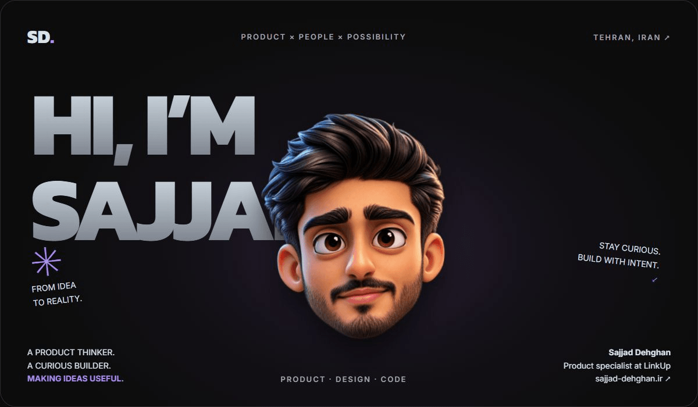</picture></a>

  <a href="https://sajjad-dehghan.ir/"><b>THE WEBSITE ↗</b></a> &nbsp; / &nbsp;
  <a href="https://www.linkedin.com/in/sajjaddehghan/"><b>LINKEDIN ↗</b></a> &nbsp; / &nbsp;
  <a href="mailto:sajaddehqan2002@gmail.com"><b>LET’S TALK ↗</b></a> &nbsp; / &nbsp;
  <a href="https://sajjad-dehghan.ir/en/resume"><b>RÉSUMÉ ↗</b></a>

### The person behind the projects

I'm a product specialist with a computer engineering degree. I figure out what's worth building, sketch it, ship a small version, and watch whether people actually use it.

**Right now:** I'm building [LinkUp](https://app.welinkup.org/), a bilingual marketplace for Iranian talent and clients abroad. I work on product strategy, user journeys, AI-assisted proposal writing, shared workspaces, and trust and payment flows.

**Ideas are cheap. Making them useful is the craft.**

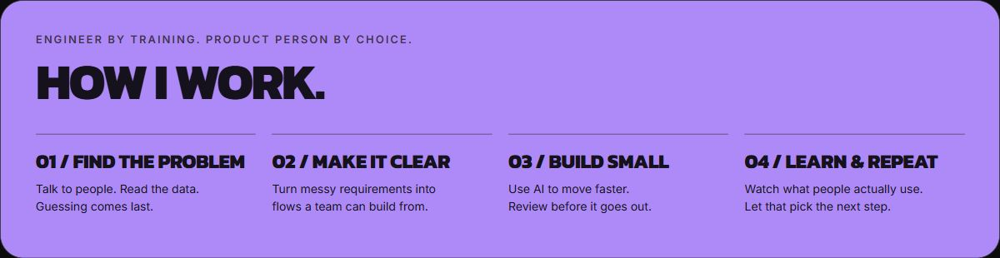

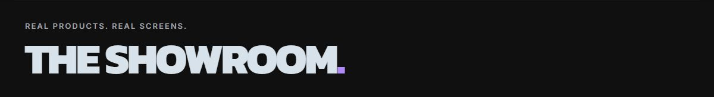

Each preview opens a showroom with more views and context. These are **actual implementation captures**, not invented mockups; prototypes and offline runs use demo data. My role varies by project, from product contribution to implementation.

<table>
  <tr>
    <td width="50%" valign="top"><a href="https://sajjad-dehghan.ir/projects/linkup-product">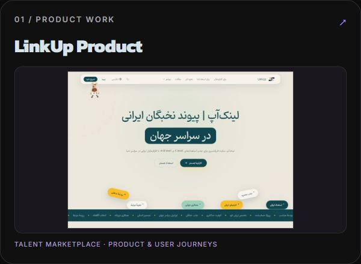</a> <b><a href="https://sajjad-dehghan.ir/projects/linkup-product">LinkUp Product ↗</a></b> Product strategy, user journeys and MVP delivery for a bilingual talent marketplace.</td>
    <td width="50%" valign="top"><a href="https://sajjad-dehghan.ir/projects/baxi">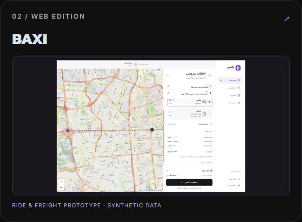</a> <b><a href="https://sajjad-dehghan.ir/projects/baxi">BAXI ↗</a></b> Ride and freight web prototype; passenger, driver, wallet and HR journeys. Synthetic demo data. <a href="https://github.com/sajjad-dehghan/BAXI">Source</a></td>
  </tr>
  <tr>
    <td width="50%" valign="top"><a href="https://sajjad-dehghan.ir/projects/chatterai">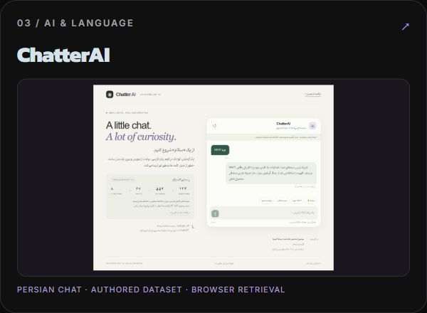</a> <b><a href="https://sajjad-dehghan.ir/projects/chatterai">ChatterAI ↗</a></b> Persian retrieval demo with an authored 67-topic dataset. Original Python BoW/LSTM code preserved; ChatGPT is not connected. <a href="https://github.com/sajjad-dehghan/ChatterAI">Source</a></td>
    <td width="50%" valign="top"><a href="https://sajjad-dehghan.ir/projects/sandwich-download-manager">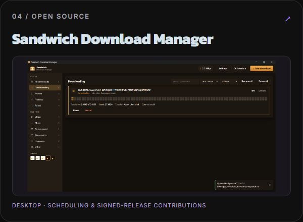</a> <b><a href="https://sajjad-dehghan.ir/projects/sandwich-download-manager">Sandwich Download Manager ↗</a></b> Open-source Tauri download manager. My contributions include scheduling and the signed-release pipeline. <a href="https://github.com/sepehrbayat/sandwich-download-manager">Source</a></td>
  </tr>
  <tr>
    <td width="50%" valign="top"><a href="https://sajjad-dehghan.ir/projects/dariwall">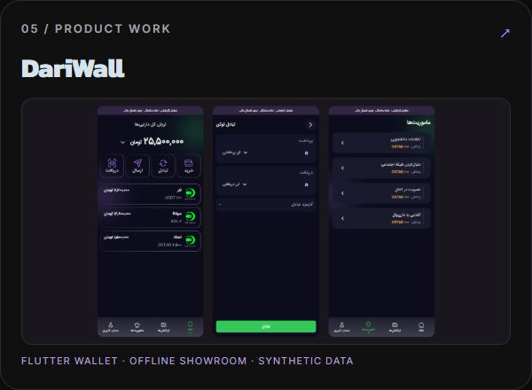</a> <b><a href="https://sajjad-dehghan.ir/projects/dariwall">DariWall ↗</a></b> Product contribution to a Persian digital wallet. Actual Flutter frontend with synthetic offline data, not a live financial service. <a href="https://github.com/Muhammad1831/Dariwall">Source</a></td>
    <td width="50%" valign="top"><a href="https://sajjad-dehghan.ir/projects/osgolia">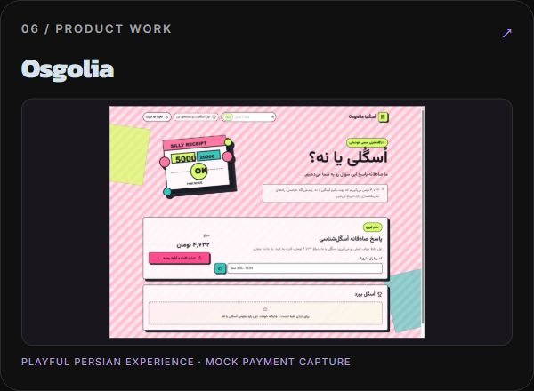</a> <b><a href="https://sajjad-dehghan.ir/projects/osgolia">Osgolia ↗</a></b> Product contribution to a playful Persian experience: payment journey, leaderboard and personalized certificates.</td>
  </tr>
  <tr>
    <td width="50%" valign="top"><a href="https://sajjad-dehghan.ir/projects/dino-dash">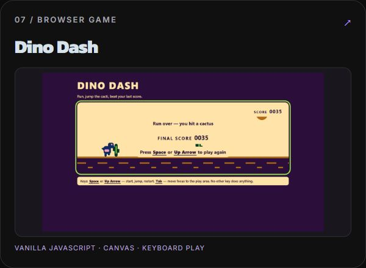</a> <b><a href="https://sajjad-dehghan.ir/projects/dino-dash">Dino Dash ↗</a></b> A colorful, keyboard-playable browser runner built with vanilla JavaScript and Canvas. <a href="https://github.com/sajjad-dehghan/dino-dash">Source</a></td>
    <td width="50%" valign="top"><a href="https://sajjad-dehghan.ir/projects/four-in-a-row">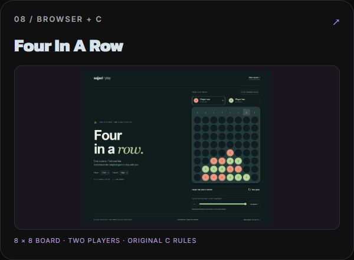</a> <b><a href="https://sajjad-dehghan.ir/projects/four-in-a-row">Four In A Row ↗</a></b> Two-player Connect Four with an 8 × 8 browser edition; original C terminal game and replayable saves preserved. <a href="https://github.com/sajjad-dehghan/Four-In-A-Row-Game">Source</a></td>
  </tr>
  <tr>
    <td width="50%" valign="top"><a href="https://sajjad-dehghan.ir/projects/tic-tac-py">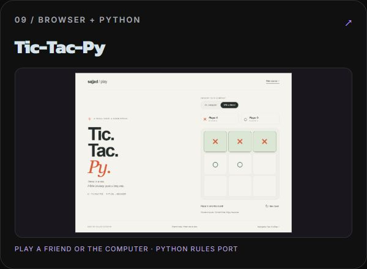</a> <b><a href="https://sajjad-dehghan.ir/projects/tic-tac-py">Tic-Tac-Py ↗</a></b> Play a friend or the computer. Browser edition of the original Python game's rules, with the terminal source retained. <a href="https://github.com/sajjad-dehghan/Tic-Tac-Py">Source</a></td>
    <td width="50%" valign="top"><a href="https://sajjad-dehghan.ir/projects/wrist-motion">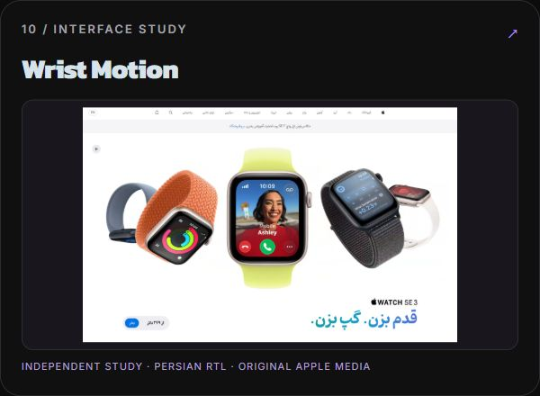</a> <b><a href="https://sajjad-dehghan.ir/projects/wrist-motion">Wrist Motion ↗</a></b> Independent interface study: Persian localization, responsive RTL/LTR and product motion. Original product imagery belongs to Apple; no affiliation claimed. <a href="https://github.com/sajjad-dehghan/wrist-motion">Source</a></td>
  </tr>
</table>

### Nocturne Reserve

[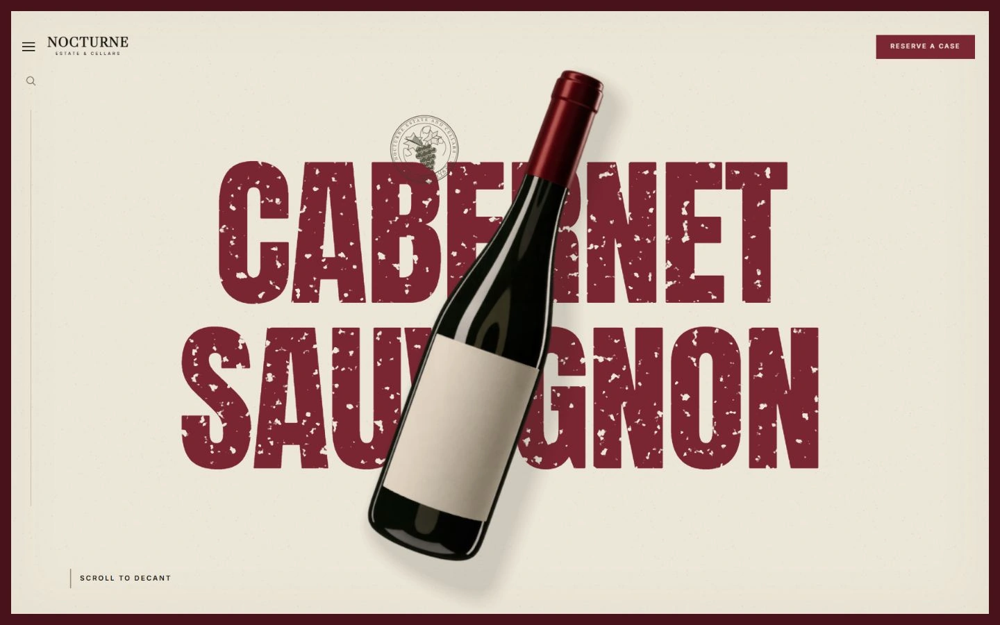](https://sajjad-dehghan.ir/projects/nocturne-reserve)

An independent editorial interface study: aged paper, oversized type and scroll-driven WebGL product motion. JavaScript / Vite / Three.js / GSAP, with six editable GLB assets. [Explore six desktop and mobile views ↗](https://sajjad-dehghan.ir/projects/nocturne-reserve) · [Source ↗](https://github.com/sajjad-dehghan/nocturne-reserve).

Reference: Vesper by Scrolltide, with no affiliation. The screenshot shows the implemented interface; its product imagery and editorial scenes are AI-generated. Hybrid photographic/WebGL bottle rendering, not a fully volumetric viewer. Reservations and sign-ups are localStorage demonstrations, not real orders.

### BRWW Coffee in Motion

[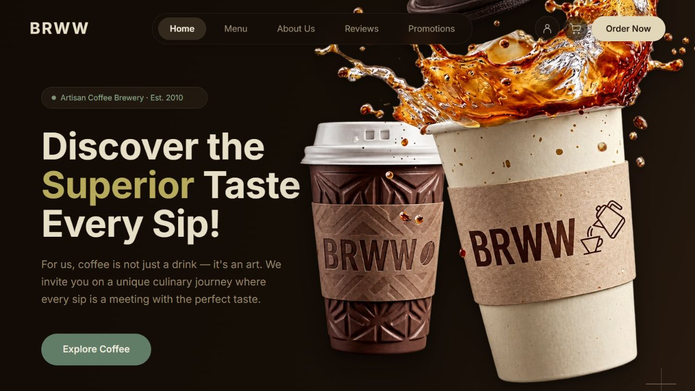](https://sajjad-dehghan.ir/projects/brww-coffee-in-motion)

A warm coffee storefront study with pointer depth, a seven-part editable Three.js cup and quiet scroll entrances. Vanilla JavaScript, responsive layouts and browser-local cart and coffee quiz. [Explore nine desktop and mobile views ↗](https://sajjad-dehghan.ir/projects/brww-coffee-in-motion) · [Live demo ↗](https://sajjad-dehghan.github.io/brww-coffee-in-motion/) · [Source ↗](https://github.com/sajjad-dehghan/brww-coffee-in-motion).

Independent study referencing Coffee by Scrolltide, with no affiliation. The screenshot shows the running interface; coffee artwork and textures are AI-assisted. Brand claims and ratings are illustrative. No real account authentication, payment or order backend is connected.

**[Explore the full portfolio →](https://sajjad-dehghan.ir/en#all-projects)** · **[ویترین فارسی →](https://sajjad-dehghan.ir/fa#all-projects)**

<b>More of the exploration — products, tools, games and data</b>

- **Product work:** [Open Product Operations OS](https://github.com/sajjad-dehghan/open-product-operations-os) · [ProductDashboard](https://sajjad-dehghan.ir/projects/productdashboard) · [LinkVest Product](https://sajjad-dehghan.ir/projects/linkvest-product) · [BoomRoom](https://sajjad-dehghan.ir/projects/boomroom)
- **Tools & apps:** [Ticket Reservation](https://github.com/sajjad-dehghan/Ticket-reservation) · [BASU Rental](https://github.com/sajjad-dehghan/basu-rental) · [AI Radar](https://sajjad-dehghan.ir/projects/ai-radar) · [Dars Ba Ki Bardaram Bot](https://sajjad-dehghan.ir/projects/dars-ba-ki-bardaram-bot) · [DonkeyNet](https://github.com/sajjad-dehghan/DonkeyNet) · [Giraffe Login Experience](https://github.com/sajjad-dehghan/giraffe-login-experience) · [Province Road Network](https://github.com/sajjad-dehghan/province-road-network-dijkstra)
- **Another game:** [Hungry Snake Adventure](https://github.com/sajjad-dehghan/Hungry-Snake-Adventure) — original C++ / SFML gameplay.
- **AI & data:** [Image2Text Translate](https://github.com/sajjad-dehghan/Image2Text-Translate) · [Congressional Voting Analysis](https://github.com/sajjad-dehghan/congressional-voting-analysis) · [Obesity Level Prediction](https://github.com/sajjad-dehghan/obesity-level-prediction) · [Mobile Price Classification](https://github.com/sajjad-dehghan/mobile-price-classification) · [Noise Type Classification](https://github.com/sajjad-dehghan/noise-type-classification) · [Salary Linear Regression](https://github.com/sajjad-dehghan/salary-linear-regression-pytorch)

Private work links to its public showroom, not to inaccessible repositories. Image origins and prototype limitations are documented in [the artwork notes](./assets/2026/source/NOTES.md).

### The journey

- **Product specialist · LinkUp**, April 2025 — present.
- **B.Sc. Computer Engineering · Bu-Ali Sina University**, 2021 — 2025.
- **Leadership roles · Computer Engineering Scientific Association**, 2022 — 2025. Helped organize 100+ academic and cultural events.
- **Teaching assistant / Head TA**, AI, Data Structures and Basic Programming; also taught Advanced Programming exercise sessions.
- **AI intern · Amadast**, 2023. NLP and retrieval-augmented generation experiments.
- **20th · ICPC Asia Regional**, Tehran 2024.

**Always a student:** [Product Management Bootcamp · Diginext](https://sajjad-dehghan.ir/certificates/product-management-bootcamp.jpg) / [Design Thinking](https://sajjad-dehghan.ir/certificates/design-thinking-fa.webp) / [Product Discovery](https://sajjad-dehghan.ir/certificates/product-discovery-fa.webp) / [Marketing Principles · Hamrah Academy](https://sajjad-dehghan.ir/certificates/marketing-principles.jpg) / [Scrum Mastery · FaraDars](https://faradars.org/verify/0095AD26).

### In the mix

**Product:** strategy · discovery · user journeys · UX & prototyping · MVP scoping · prioritization · Product Ops · Scrum 
**Build:** AI-assisted execution · TypeScript · React / Next.js · Cloudflare · Python · SQL 
**Collaborate:** Figma · Git / GitHub · documentation · cross-functional delivery · QA

### Keep building

<picture>
  <source media="(prefers-color-scheme: dark)" srcset="https://raw.githubusercontent.com/sajjad-dehghan/sajjad-dehghan/output/github-activity-snake-dark.svg?v=creator2026" />
  <source media="(prefers-color-scheme: light)" srcset="https://raw.githubusercontent.com/sajjad-dehghan/sajjad-dehghan/output/github-activity-snake.svg?v=creator2026" />
  
</picture>

Real contribution activity, refreshed daily. The graph follows GitHub's visible contribution settings; private repository details are never exposed.

  

<a href="mailto:sajaddehqan2002@gmail.com">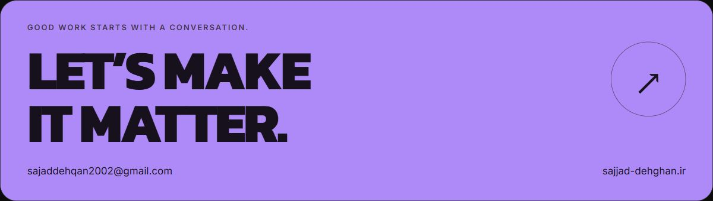</a>
